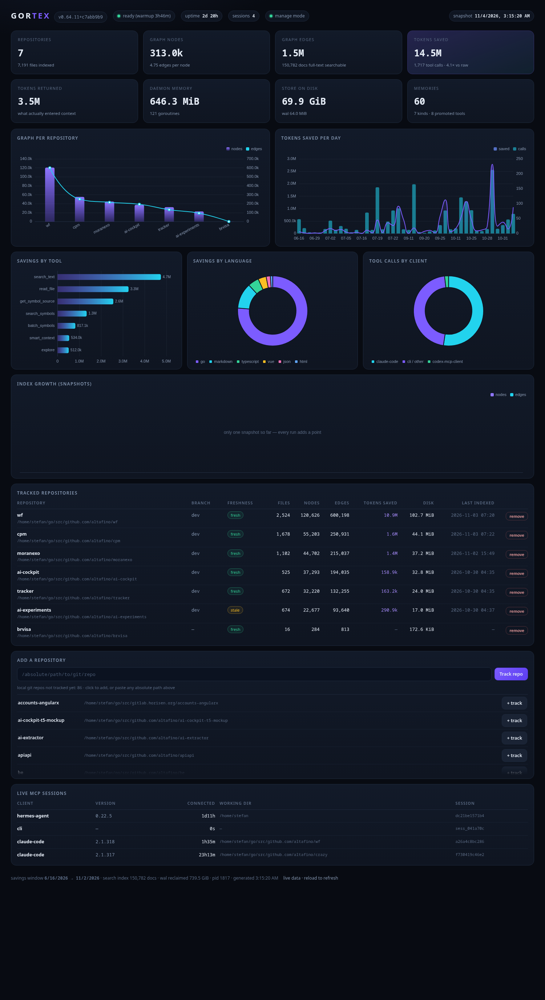

# gortex-dashboard

A Claude Code plugin (and a plain skill) that renders a local dashboard for
[Gortex](https://github.com/zzet/gortex) — the code-intelligence engine — straight from the
running daemon. Everything is local: no network calls, no telemetry, no API keys.



## What it shows

| Panel | Data |
|---|---|
| KPI cards | daemon version, uptime, sessions, repos/files, graph nodes, edges, tokens saved (× vs raw), memory, on-disk store, memories |
| Graphs | nodes + edges per repository; index growth across snapshots |
| Savings | tokens saved per day, by tool, by language, by MCP client |
| Tables | every tracked repo (branch, fresh/stale, files, nodes, edges, tokens saved, disk, last indexed) and the live MCP sessions |
| Manage | in `--serve` mode: one-click **track** of any untracked local git repo, **remove** any tracked one |

## Install

### 1. As a Claude Code plugin (recommended)

```bash
claude plugin marketplace add altafino/gortex-dashboard
claude plugin install gortex-dashboard@altafino
```

Inside a session the one-liner works too: `/plugin install gortex-dashboard --marketplace altafino/gortex-dashboard`.

Then in a session: `/gortex-dashboard:dashboard` — or just ask "open the gortex dashboard".

### 2. From a release tarball (no marketplace)

Grab the skill bundle from [Releases](https://github.com/altafino/gortex-dashboard/releases/latest):

```bash
curl -LO https://github.com/altafino/gortex-dashboard/releases/latest/download/gortex-dashboard-skill.tar.gz
mkdir -p ~/.claude/skills
tar xzf gortex-dashboard-skill.tar.gz -C ~/.claude/skills
```

That drops `~/.claude/skills/dashboard/` in place; Claude picks it up as the `dashboard` skill.
The same directory works for any Agent Skills host (Hermes, Codex, …) — point the host's skill
directory at it.

### 3. Straight from a clone (no install)

```bash
git clone https://github.com/altafino/gortex-dashboard
claude --plugin-dir ./gortex-dashboard/plugins/gortex-dashboard
```

## Use

```bash
python3 <skill-dir>/scripts/gortex-dashboard.py --open    # static page
python3 <skill-dir>/scripts/gortex-dashboard.py --serve   # live page + repo management
```

The page is written to `~/.local/share/gortex-dashboard/index.html`; ECharts is cached beside it
so it opens offline. `--serve` binds `127.0.0.1:8899` (change with `--port`) and enables the
Track / remove buttons, which shell out to `gortex track` and `gortex untrack`.

Other flags: `--no-snapshot` (render without recording history), `--print` (dump the collected
JSON), `--out PATH`, `--no-open`.

## Requirements

- `gortex` on `PATH` with a running daemon (`gortex daemon status` answers)
- Python 3.9+ (stdlib only)
- Linux or macOS for the browser hand-off (`--open` uses `webbrowser`)

## Repository layout

```
.claude-plugin/marketplace.json         marketplace "altafino" → lists this plugin
plugins/gortex-dashboard/
  .claude-plugin/plugin.json            plugin manifest
  skills/dashboard/SKILL.md             the skill Claude loads
  skills/dashboard/scripts/gortex-dashboard.py
docs/preview.png
Makefile                                validate · package · release
```

## Developing

```bash
make validate    # claude plugin validate on the plugin + the marketplace
make run         # serve the dashboard from the working tree
make package     # dist/gortex-dashboard-plugin.tar.gz + dist/gortex-dashboard-skill.tar.gz
make release VERSION=v1.0.1   # tag, build, publish a GitHub release with the assets
```

## License

Apache-2.0. See [LICENSE](LICENSE).
